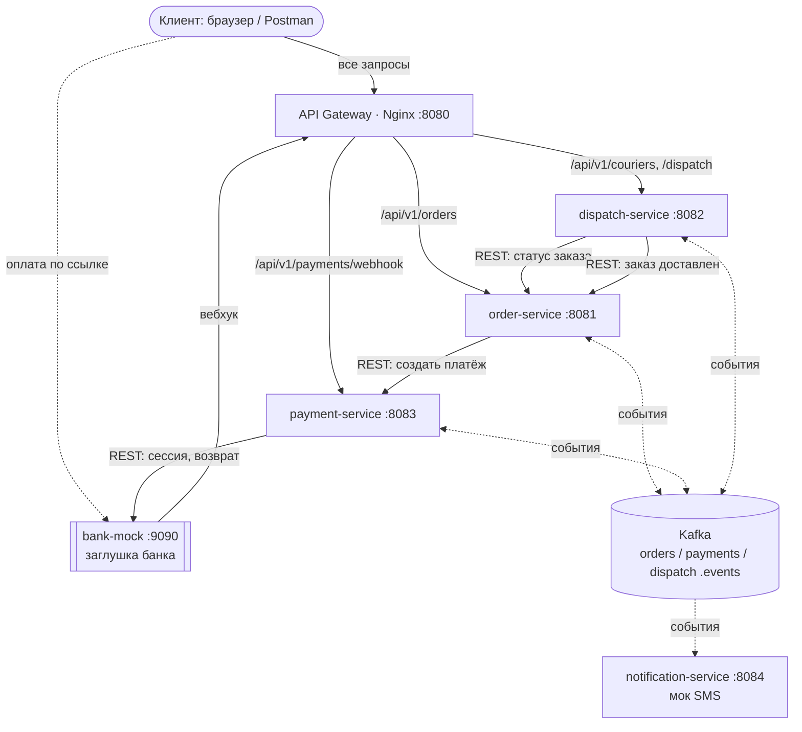
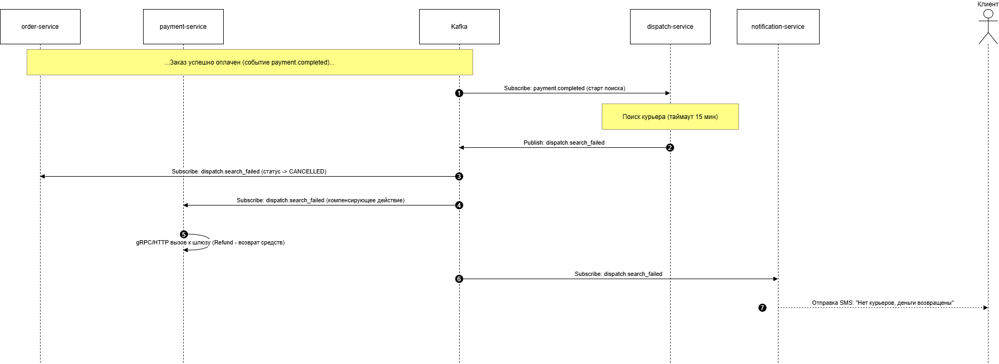

# Лабораторная работа №5. CI/CD

[](https://github.com/Nikita-Solokha/micros_labs/actions/workflows/ci-cd.yml)

**Работающий пайплайн:** [Actions → CI/CD](https://github.com/Nikita-Solokha/micros_labs/actions/workflows/ci-cd.yml) · конфигурация: [`.github/workflows/ci-cd.yml`](.github/workflows/ci-cd.yml) · подробное описание, скриншоты и инструкции: [docs/cicd.md](docs/cicd.md).

Платформа — **GitHub Actions** (репозиторий уже на GitHub, бесплатные раннеры с Docker, встроенный реестр GHCR и секрет `GITHUB_TOKEN`).

| Этап | Что происходит |
| :--- | :--- |
| **checks** | `gofmt`, `go vet`, проверка OpenAPI-спецификаций по стандарту OpenAPI 3.1 |
| **build** | `go build` каждого сервиса — матрица из 5 элементов (4 сервиса + bank-mock) по одному шаблону |
| **test** | unit-тесты сервиса с `-race` и отчётом покрытия; отдельно — сквозные тесты саги (`tests/e2e`); отчёт об уязвимостях (`govulncheck`) |
| **package** | сборка Docker-образа сервиса (кэш слоёв в GitHub Actions) |
| **publish** (CD) | push образов в GitHub Container Registry `ghcr.io/nikita-solokha/delivery-<сервис>` с тегами `sha-<коммит>` и `latest` — только для `main` |
| **deploy** (CD) | staging-окружение: `docker compose` поднимает всю систему **из опубликованных образов** прямо на раннере и прогоняет smoke-тест (20 проверок: успешный сценарий и сага с компенсацией) |

Запуск: автоматически при **push в `main`** (CI + CD) и при **Pull Request** в `main` (только CI), вручную — кнопкой *Run workflow*. Секреты: только встроенный `GITHUB_TOKEN` с минимальными правами — в коде ключей нет.

**Как проверить:** открыть [Actions](https://github.com/Nikita-Solokha/micros_labs/actions/workflows/ci-cd.yml) → последний прогон; образы — в разделе Packages; деплои — Environments → staging. Локально те же проверки: `gofmt -l .`, `go vet ./...`, `go test ./...`, а CD-часть — `docker compose up -d --build` и `scripts/test-saga.ps1` (подробно — [docs/cicd.md](docs/cicd.md#8-как-проверить-работу-пайплайна)).

---

# Лабораторная работа №4. Реализация микросервисов

Реализация системы доставки посылок, спроектированной в [лабораторной работе №3](#лабораторная-работа-3-декомпозиция-и-проектирование-микросервисной-системы) (описание предметной области, архитектура и контракты — ниже в этом же файле).

## Стек технологий

| Что | Выбор | Почему |
| :--- | :--- | :--- |
| Язык | **Go 1.27** | Статически собранный бинарник без зависимостей → маленькие Docker-образы и быстрый старт; горутины удобны для фоновых задач (поиск курьера, чтение Kafka); выбран ещё в ЛР3. |
| HTTP | стандартная библиотека `net/http` | Роутер Go 1.22+ поддерживает методы и параметры пути (`POST /api/v1/orders/{id}`) — фреймворк не нужен. |
| Брокер | **Apache Kafka 3.9** (KRaft) + клиент `segmentio/kafka-go` | Как в ЛР3: несколько независимых подписчиков на событие, порядок событий одного заказа (ключ = `orderId`). |
| API Gateway | **Nginx** | Маршрутизация, закрытие `/internal`, rate limiting, `X-Request-Id` — без кода. |
| Запуск | **Docker Compose** | Вся система одной командой. |
| Тесты | `testing` + `net/http/httptest` | Unit-тесты, тесты эндпоинтов и сквозные тесты саги без внешних зависимостей. |

## Что реализовано

| Сервис | Порт | Ответственность |
| :--- | :--- | :--- |
| `order-service` | 8081 | Заказы и их конечный автомат (`PENDING_PAYMENT → PAID → ASSIGNED → DELIVERED`, `CANCELLED`), расчёт цены, первый шаг саги |
| `dispatch-service` | 8082 | Смены и координаты курьеров, подбор ближайшего свободного курьера, таймаут поиска |
| `payment-service` | 8083 | Платежи, вебхук банка (подпись HMAC-SHA256), возвраты — компенсирующее действие |
| `notification-service` | 8084 | SMS клиенту по событиям, журнал отправок |
| `gateway` (Nginx) | **8080** | Единственная точка входа клиента |
| `bank-mock` | 9090 | Заглушка внешнего платёжного шлюза |
| Kafka / Kafka UI | 9092 / 8090 | Брокер событий и веб-интерфейс к нему |

Архитектура реализованной системы (схемы в `docs/*.png` — проектные, из ЛР3: там ещё gRPC, PostgreSQL/Redis и Prometheus):



Сплошные стрелки — синхронные HTTP-вызовы, пунктир — асинхронные события через Kafka.

Все 4 бизнес-сервиса из ЛР3 реализованы. Общий код — в `pkg/`:

* `pkg/problem` — **единая модель ошибок** RFC 7807 (`application/problem+json`: `type`, `title`, `status`, `detail`, `instance`) во всех сервисах и в gateway;
* `pkg/idempotency` — **`Idempotency-Key`** (повтор → сохранённый ответ с заголовком `Idempotent-Replayed: true`, тот же ключ с другим телом → 409) и дедупликация событий по `eventId`;
* `pkg/events` — конверт события (`eventId`, `eventType`, `schemaVersion`, `occurredAt`, `correlationId`, `payload`), брокеры Kafka и in-memory, DLQ;
* `pkg/httpx` — JSON, логирование каждого запроса (JSON-логи `slog`), сквозной `X-Request-Id`, перехват паник;
* `pkg/webhook` — подпись вебхуков банка.

### Взаимодействия

**Синхронные (REST), 3 шт.:**

| № | Откуда → куда | Эндпоинт | Зачем | Надёжность |
| :--- | :--- | :--- | :--- | :--- |
| 1 | order → payment | `POST /internal/v1/payments` | создать платёж, получить `paymentUrl` | таймаут 2 с, 3 повтора на 5xx/сеть, circuit breaker (5 ошибок → пауза 15 с), `Idempotency-Key = orderId` |
| 2 | dispatch → order | `GET /internal/v1/orders/{id}/status` | перед назначением курьера убедиться, что заказ не отменён | таймаут, повторы; при недоступности назначение откладывается |
| 3 | dispatch → order | `POST /internal/v1/orders/{id}/delivered` | курьер доставил заказ | таймаут, повторы; курьер освобождается только после подтверждения |

**Асинхронные (Kafka):**

| Топик | Событие | Издатель | Подписчики |
| :--- | :--- | :--- | :--- |
| `orders.events` | `order.created` | order | dispatch (копия адреса забора) |
| `orders.events` | `order.delivered` | order | notification |
| `payments.events` | `payment.completed` | payment | order (→ `PAID`), dispatch (старт поиска) |
| `payments.events` | `payment.failed` | payment | order (→ `CANCELLED`) |
| `payments.events` | `payment.refunded` | payment | — (для аудита) |
| `dispatch.events` | `dispatch.courier_assigned` | dispatch | order (→ `ASSIGNED`), notification |
| `dispatch.events` | `dispatch.search_failed` | dispatch | order (→ `CANCELLED`), **payment (возврат)**, notification |

Гарантии: ключ сообщения = `orderId` (порядок в пределах заказа), offset коммитится после успешной обработки (at-least-once), дубли отсекаются по `eventId`, 5 неудачных попыток → `<топик>.dlq`. Если событие пришло раньше, чем к нему готов сервис (например, `courier_assigned` раньше `payment.completed`), обработчик возвращает ошибку и событие перечитывается.

### Сага «оформление заказа»

```
order: заказ PENDING_PAYMENT ──REST──▶ payment: платёж + ссылка банка
клиент платит ──▶ bank-mock ──вебхук через gateway──▶ payment ──payment.completed──▶ order: PAID
                                                                         └──────────▶ dispatch: поиск курьера
dispatch ──REST: статус заказа──▶ order;  курьер найден ──courier_assigned──▶ order: ASSIGNED, notification: SMS
курьер ──▶ dispatch ──REST: delivered──▶ order: DELIVERED ──order.delivered──▶ notification: SMS
```

Компенсации:

| Сбой | Что происходит |
| :--- | :--- |
| payment-service недоступен при создании заказа | заказ `CANCELLED` (`PAYMENT_SERVICE_UNAVAILABLE`), клиенту 503 |
| банк отклонил оплату | `payment.failed` → заказ `CANCELLED` (`PAYMENT_FAILED`), поиск курьера не начинается |
| курьер не найден за `SEARCH_TIMEOUT` | `dispatch.search_failed` → заказ `CANCELLED` (`COURIER_NOT_FOUND`), payment возвращает деньги, клиенту SMS |
| банк недоступен при возврате | обработчик возвращает ошибку → Kafka доставляет событие повторно, платёж остаётся `COMPLETED` |
| order-service недоступен для dispatch | назначение/завершение доставки откладывается, повторяется позже |
| повторная доставка события / повторный вебхук | игнорируется (дедупликация по `eventId` и по статусу) |

## Что через моки, а что — реальное

| Компонент / взаимодействие | Как реализовано |
| :--- | :--- |
| 4 бизнес-сервиса, REST-вызовы между ними | **реальные**, отдельные контейнеры, настоящий HTTP |
| Брокер сообщений | **реальная Kafka** в docker-compose (в unit- и e2e-тестах — in-memory шина с тем же интерфейсом) |
| API Gateway | **реальный Nginx** (без проверки JWT — см. ниже) |
| Платёжный шлюз банка | **мок** `mocks/bank-mock` (HTTP-сервис: сессии оплаты, подписанный вебхук, возвраты; `FAIL_REFUNDS=true` — сбой возвратов) |
| SMS-провайдер | **мок** внутри notification-service (пишет SMS в лог; `SMS_FAIL=true` — провайдер недоступен) |
| Геокодер адресов | **мок** внутри dispatch-service (адрес детерминированно отображается в точку в Ростове-на-Дону) |
| Хранилища (PostgreSQL, Redis в ЛР3) | **in-memory** у каждого сервиса своё (разрешено условием ЛР4); доступ через отдельный `store.go`, поэтому замена на БД затрагивает один файл. TTL координат курьеров (60 с) повторяет поведение Redis |
| Авторизация (Keycloak) | не реализована; клиент передаёт `X-Client-Id`, в продакшене его проставлял бы gateway из JWT |
| Prometheus + Grafana | не реализованы (не требуются ЛР4); вместо метрик — структурированные JSON-логи с `requestId` |

## Запуск

Нужны Docker Desktop и (для тестов) Go 1.24+.

```powershell
docker compose up -d --build     # вся система; первая сборка ~3-5 минут
docker compose ps                # все Up/healthy, kafka-init — Exited (0)
```

* API Gateway: http://localhost:8080
* Kafka UI: http://localhost:8090
* Логи сервиса: `docker logs -f order-service`
* Остановка: `docker compose down`

Демонстрационные параметры (переменные окружения хоста):

| Переменная | По умолчанию | Смысл |
| :--- | :--- | :--- |
| `SEARCH_TIMEOUT` | `20s` | сколько ищем курьера (по ТЗ — `15m`, для демонстрации уменьшено) |
| `SMS_FAIL` | `false` | SMS-провайдер «лежит» |
| `FAIL_REFUNDS` | `false` | банк не может сделать возврат |

Пример: `$env:FAIL_REFUNDS="true"; docker compose up -d bank-mock`.

Без Docker каждый сервис можно запустить отдельно: `go run ./services/order-service` (тогда используется in-memory брокер; для Kafka задать `KAFKA_BROKERS=localhost:9092`).

## Проверка

**Тесты Go** (59 тестов):

```powershell
go test ./...
```

| Пакет | Тестов | Что проверяется |
| :--- | :---: | :--- |
| `payment-service/app` | 12 | валидация, подпись вебхука, идемпотентность, возвраты, реакция на `search_failed`, эндпоинты |
| `order-service/app` | 20 | цена, валидация, конечный автомат, сага на событиях, порядок событий, HTTP-клиент к payment против мок-сервера (контракт, повторы, circuit breaker), пагинация |
| `dispatch-service/app` | 17 | расстояния, подбор ближайшего, TTL координат, отсутствие двойного назначения (конкурентно), таймаут → `search_failed`, недоступность order, HTTP-клиент к order |
| `notification-service/app` | 6 | тексты SMS, дедупликация, сбой провайдера, журнал с пагинацией |
| `tests/e2e` | 4 | **сквозные тесты саги**: три сервиса по настоящему HTTP + общий брокер: успех, курьер не найден, отказ банка, payment недоступен |

**Живая проверка** работающей системы (PowerShell-скрипты в `scripts/`, выводят PASS/FAIL):

```powershell
powershell -ExecutionPolicy Bypass -File scripts\test-gateway.ps1
powershell -ExecutionPolicy Bypass -File scripts\test-saga.ps1 -Order http://localhost:8080 -Dispatch http://localhost:8080
```

`test-payment.ps1`, `test-order.ps1`, `test-kafka.ps1` — проверки отдельных сервисов при запуске через `go run`.

**Postman:** коллекция `postman/delivery-lab4.postman_collection.json` — сценарии по шагам, переменные (`orderId`, `paymentUrl`, …) заполняются автоматически.

Подробное описание проверенных сценариев — [docs/demo-scenarios.md](docs/demo-scenarios.md).

## Изменения относительно ЛР3

* Синхронные вызовы — **REST вместо gRPC**: контракты в `api/*.yaml` изначально описаны как REST, а gRPC потребовал бы отдельных proto-контрактов.
* Добавлены 2 синхронных взаимодействия dispatch → order (требование ЛР4 — не менее 3): `GET /internal/v1/orders/{id}/status` (был в спецификации) и новый `POST /internal/v1/orders/{id}/delivered` — заодно закрыт пробел «как заказ становится `DELIVERED`».
* Новые эндпоинты: `POST /api/v1/couriers/{courierId}/assignment/complete`, `GET /internal/v1/payments/{paymentId}`, фильтр `orderId` в журнале уведомлений.
* Описана схема события `payment.failed` и обработка отказа оплаты.
* dispatch-service подписан на `order.created` и хранит копию адреса забора (владелец данных — order-service).
* Статус нового заказа — `PENDING_PAYMENT` (как в спецификации).
* Спецификации в `api/` дополнены (новые эндпоинты, коды 409/503, поля заказа `price`, `courierId`, `cancelReason`).

## Структура репозитория

```
api/                   OpenAPI-спецификации (ЛР3, дополнены в ЛР4)
docs/                  схемы (ЛР3) и demo-scenarios.md
pkg/                   общий код сервисов
services/<name>/       main.go + app/ (model, store, service, handlers, клиенты, тесты)
mocks/bank-mock/       заглушка платёжного шлюза
gateway/nginx.conf     API Gateway
tests/e2e/             сквозные тесты саги
scripts/               PowerShell-скрипты живой проверки
postman/               Postman-коллекция
Dockerfile, docker-compose.yml
```

---

# Лабораторная работа №3. Декомпозиция и проектирование микросервисной системы

## Шаг 1. Анализ предметной области

### Описание системы
Система предназначена для оформления заявок на доставку посылок и автоматического распределения этих заявок между свободными курьерами. Платформа обслуживает клиентов (отправителей) и курьеров, а также обеспечивает прозрачное финансовое взаимодействие и информирование участников о статусе заказа.

### Акторы
* **Клиент** — создает заказы, оплачивает доставку, отслеживает статус выполнения.
* **Курьер** — выходит на смену, принимает назначенные заказы, обновляет статус доставки.
* **Платёжный шлюз (внешняя система)** — обрабатывает транзакции по картам (списание и возврат средств).
* **SMS-провайдер (внешняя система)** — отправляет уведомления клиентам и курьерам.

### Ключевые пользовательские сценарии
1. **Как клиент**, я хочу создать заказ на доставку с указанием адресов и параметров посылки, чтобы отправить груз.
2. **Как клиент**, я хочу оплатить доставку картой по выданной ссылке, чтобы заказ перешел в статус поиска курьера.
3. **Как курьер**, я хочу выйти на смену (статус «онлайн») и передавать координаты, чтобы мне начали поступать заказы.
4. **Как система**, я хочу автоматически найти ближайшего свободного курьера в Redis и назначить его на оплаченный заказ.
5. **Как курьер**, я хочу отметить заказ как «доставлен», чтобы завершить работу и зафиксировать выполнение.
6. **Как клиент**, я хочу получить SMS-уведомление о назначении курьера, чтобы знать, когда заберут посылку.
7. **Как система**, если за 15 минут курьер не найден, я хочу автоматически отменить заказ и вернуть клиенту деньги (компенсация).

### Доменные события
* `ЗаказСоздан` (`order.created`)
* `ОплатаПрошла` (`payment.completed`)
* `ОплатаОтклонена` (`payment.failed`)
* `КурьерНазначен` (`dispatch.courier_assigned`)
* `ПоискКурьераТаймаут` (`dispatch.search_failed`)
* `ЗаказДоставлен` (`order.delivered`)

### Ограниченные контексты и глоссарий

#### 1. Контекст Заказов (Order Management)
* **Заказ** — заявка на доставку с адресами отправителя и получателя, габаритами и текущим статусом жизненного цикла.
* **Клиент** — пользователь системы, выступающий заказчиком услуги доставки.
* **Посылка** — физический объект доставки, обладающий весом и габаритами.
* **Статус заказа** — состояние заявки (`PENDING_PAYMENT`, `PAID`, `ASSIGNED`, `DELIVERED`, `CANCELLED`).

#### 2. Контекст Диспетчеризации (Dispatch & Couriers)
* **Курьер** — исполнитель со статусом занятости (свободен/занят) и текущей геопозицией.
* **Назначение** — временная или постоянная связь между конкретным заказом и назначенным курьером.
* **Смена** — период активности курьера в системе («на линии» / «офлайн»).
* **Геопозиция** — координаты исполнителя (lat, lon) с временным штампом фиксации.

#### 3. Контекст Финансов (Billing)
* **Платёж** — транзакция списания денежных средств через внешний платёжный шлюз.
* **Возврат (Refund)** — компенсирующая операция возврата средств клиенту при отмене заказа.
* **Платёжная ссылка** — URL для перенаправления клиента на форму ввода реквизитов карты.

---

## Шаг 2. Список и описание сервисов

### Карточки сервисов

#### 1. `order-service`
* **Ответственность:** Управление жизненным циклом заказа на доставку, валидация адресов, хранение истории.
* **Владеет данными:** `Заказ`, `Отправитель`, `ПараметрыПосылки`.
* **Предоставляет:** Синхронный REST API для создания/получения заказа; публикует события `order.created`, `order.delivered`.
* **Зависит от:** Синхронного REST-вызова к `payment-service` (создание платежа); событий `payment.completed`, `payment.failed`, `dispatch.courier_assigned`, `dispatch.search_failed`.
* **Нефункциональные требования:** Высокая доступность на чтение (клиенты регулярно опрашивают статус заказа).
* **Обоснование границы:** Ядро бизнес-логики с собственной конечной машиной состояний (state machine), отделенное от логики исполнителей и платежей.

#### 2. `dispatch-service`
* **Ответственность:** Прием геопозиций курьеров, управление сменами, поиск ближайших исполнителей по радиусу и назначение на заказ.
* **Владеет данными:** `Курьер`, `Смена`, `Геопозиция`, `Назначение`.
* **Предоставляет:** Синхронный REST API для курьеров (выход на смену, отправка координат); публикует события `dispatch.courier_assigned`, `dispatch.search_failed`.
* **Зависит от:** События `payment.completed` (начинает алгоритм подбора только после факта оплаты).
* **Нефункциональные требования:** Высокая нагрузка на запись (Write-heavy: курьеры шлют GPS-координаты каждые несколько секунд), низкая задержка ответа.
* **Обоснование границы:** Специфический профиль нагрузки (быстрые гео-запросы в in-memory хранилище) требует отдельного масштабирования независимо от заказов.

#### 3. `payment-service`
* **Ответственность:** Создание платежных сессий, прием вебхуков от банка, проведение возвратов при срыве заказа.
* **Владеет данными:** `Платёж`, `Возврат`, `Транзакция`.
* **Предоставляет:** Синхронный REST API (`POST /internal/v1/payments`) для генерации ссылки на оплату; публикует события `payment.completed`, `payment.failed`.
* **Зависит от:** События `dispatch.search_failed` (инициирует автоматический возврат средств).
* **Нефункциональные требования:** Строгая согласованность данных (ACID), повышенные требования к безопасности и аудиту.
* **Обоснование границы:** Изоляция интеграции с внешним банковским шлюзом предотвращает каскадные сбои всей платформы при задержках на стороне банка.

#### 4. `notification-service`
* **Ответственность:** Формирование и отправка SMS-уведомлений клиентам и курьерам о ключевых статусах.
* **Владеет данными:** `ИсторияОтправок`.
* **Предоставляет:** Внешних API не предоставляет (работает исключительно по событиям).
* **Зависит от:** Событий `dispatch.courier_assigned`, `dispatch.search_failed`, `order.delivered`.
* **Нефункциональные требования:** Сбои отправки SMS не должны блокировать основной бизнес-процесс.
* **Обоснование границы:** Вспомогательный сквозной сервис; его изоляция гарантирует автономность ядра системы при недоступности SMS-шлюза.

### Отвергнутые варианты разбиения
Рассматривалось объединение `order-service` и `dispatch-service` в единый монолитный сервис доставок. От этого варианта отказались, так как работа с курьерами требует постоянного обновления их геопозиции и статусов, что создает высокую нагрузку на базу данных. Выделение диспетчеризации в отдельный сервис позволяет масштабировать его независимо от подсистемы заказов.

---

## Шаг 3. Выбор готового ПО

Разработка сервисов предполагается на языке **Golang** в связке с контейнеризацией через **Docker** (и развертыванием локально через `docker-compose`). Синхронное взаимодействие между внутренними сервисами реализовано по **REST (HTTP/JSON)** (в проекте изначально планировался gRPC — см. «Изменения относительно ЛР3»), а внешнее API для клиентов — по **REST (HTTP)**.

| Компонент | Кто использует | Обоснование |
| :--- | :--- | :--- |
| **PostgreSQL** | `order-service`, `payment-service`, `notification-service` | Обеспечивает строгую консистентность данных и ACID-транзакции, что критически важно для финансовых операций и статусов заказов. Каждый сервис имеет свою изолированную БД. |
| **Redis** | `dispatch-service` | Используется как in-memory хранилище для частого обновления геопозиций курьеров в реальном времени (`GEOADD`/`GEORADIUS`). Поддержка TTL позволяет автоматически удалять неактуальные координаты, не перегружая основную БД. |
| **Apache Kafka** | Все сервисы | Выступает в роли брокера сообщений для реализации паттерна Сага и асинхронного взаимодействия (события `payment.completed`, `dispatch.courier_assigned`, `dispatch.search_failed`). Гарантирует доставку событий нескольким подписчикам и порядок сообщений по ключу. |
| **Nginx (API Gateway)** | Вход для клиентов и курьеров | Выполняет роль API Gateway, терминирует HTTP/SSL-трафик, маршрутизирует REST-запросы к нужным микросервисам и выступает единой точкой входа. |
| **Prometheus + Grafana** | Инфраструктура | Инфраструктурное ПО для сбора метрик (Prometheus) и их визуализации (Grafana). Позволяет мониторить нагрузку на сервисы (RPS, latency gRPC/REST вызовов, ресурсы контейнеров). |

---

## Шаг 4. Схема взаимодействий

### Архитектурная схема


### Сводная таблица взаимодействий

| № | Инициатор $\rightarrow$ Получатель | Тип | Протокол / Эндпоинт или Событие | Назначение |
|---|---|---|---|---|
| 1 | Клиент $\rightarrow$ Nginx Gateway | sync | HTTP REST: `POST /api/v1/orders` | Передача данных заказа (адреса, посылка) |
| 2 | Nginx $\rightarrow$ `order-service` | sync | HTTP REST: `POST /api/v1/orders` | Проксирование создания заказа |
| 3 | Курьер $\rightarrow$ Nginx $\rightarrow$ `dispatch-service` | sync | HTTP REST: `POST /api/v1/couriers/shifts` | Выход курьера на смену, отправка координат |
| 4 | `order-service` $\rightarrow$ `payment-service` | sync | HTTP REST: `POST /internal/v1/payments` | Создание платежа, получение paymentUrl |
| 5 | Клиент $\rightarrow$ `payment-service` / Шлюз | sync | HTTPS | Оплата заказа картой через шлюз |
| 6 | `payment-service` $\rightarrow$ Kafka | async | Топик `payments.events`: `payment.completed` | Оповещение об успешной оплате |
| 7 | Kafka $\rightarrow$ `order-service` | async | Подписка: `payment.completed` | Смена статуса заказа на `PAID` |
| 8 | Kafka $\rightarrow$ `dispatch-service` | async | Подписка: `payment.completed` | Старт поиска курьера в Redis |
| 9 | `dispatch-service` $\rightarrow$ Kafka | async | Топик `dispatch.events`: `dispatch.courier_assigned` | Публикация: курьер найден |
| 10 | Kafka $\rightarrow$ `order-service` | async | Подписка: `dispatch.courier_assigned` | Смена статуса заказа на `ASSIGNED` |
| 11 | Kafka $\rightarrow$ `notification-service` | async | Подписка: `dispatch.courier_assigned` | Триггер отправки SMS клиенту |
| 12 | `dispatch-service` $\rightarrow$ Kafka | async | Топик `dispatch.events`: `dispatch.search_failed` | Таймаут (15 мин), курьер не найден |
| 13 | Kafka $\rightarrow$ `order-service` | async | Подписка: `dispatch.search_failed` | Смена статуса заказа на `CANCELLED` |
| 14 | Kafka $\rightarrow$ `payment-service` | async | Подписка: `dispatch.search_failed` | Компенсирующее действие: возврат средств (Refund) |
| 15 | Kafka $\rightarrow$ `notification-service` | async | Подписка: `dispatch.search_failed` | SMS клиенту: «Курьер не найден, деньги возвращены» |

---

### Диаграмма последовательности: Успешный сценарий


### Диаграмма последовательности: Сценарий со сбоем (Сага)


### Механизм согласованности данных и обработка сбоев (Сага)
1. **Успешный путь:** Заказ создается в статусе `PENDING_PAYMENT`. После оплаты через шлюз `payment-service` отправляет событие `payment.completed`. Сервис заказов переводит статус в `PAID`, а `dispatch-service` начинает поиск исполнителя в Redis. При нахождении публикуется `dispatch.courier_assigned`, заказ переходит в `ASSIGNED`, клиенту уходит SMS.
2. **Сценарий сбоя и компенсация:** Если за 15 минут свободный курьер не найден, `dispatch-service` генерирует событие `dispatch.search_failed`. Это запускает цепочку распределенного отката:
   * `order-service` переводит статус заказа в `CANCELLED`.
   * `payment-service` выполняет компенсирующее действие — вызывает метод возврата средств (Refund) во внешнем платёжном шлюзе.
   * `notification-service` информирует клиента об отмене и автоматическом возврате денег.
3. **Идемпотентность и защита от дублей:** Все сообщения в Kafka содержат `eventId` и `correlationId` (соответствующий `orderId`). Сервисы сохраняют идентификаторы обработанных сообщений в локальных БД, что исключает повторное списание средств или двойную отмену заказа при сетевых сбоях и повторной доставке сообщений брокером.
4. **Идемпотентность API:** Создание заказа (`POST /api/v1/orders`) поддерживает заголовок `Idempotency-Key` (UUIDv4) для предотвращения дубликатов при повторных кликах пользователя.

---

## Перечень событий Kafka

| Топик | Издатель | Подписчики | Описание события | Схема |
| :--- | :--- | :--- | :--- | :--- |
| `orders.events` | `order-service` | `notification-service` | Создание заказа, вручение посылки | [OrderEvents](api/order-service.yaml) |
| `payments.events` | `payment-service` | `order-service`, `dispatch-service` | Подтверждение оплаты (`payment.completed`), ошибка (`payment.failed`) | [PaymentEvents](api/payment-service.yaml) |
| `dispatch.events` | `dispatch-service` | `order-service`, `payment-service`, `notification-service` | Назначение курьера (`courier_assigned`), таймаут поиска (`search_failed`) | [DispatchEvents](api/dispatch-service.yaml) |

---

## Спецификации API (OpenAPI 3.1)

Контракты взаимодействия между клиентом, API Gateway и микросервисами описаны в формате OpenAPI 3.1 и лежат в директории `api/`:
* [order-service.yaml](api/order-service.yaml)
* [dispatch-service.yaml](api/dispatch-service.yaml)
* [payment-service.yaml](api/payment-service.yaml)
* [notification-service.yaml](api/notification-service.yaml)