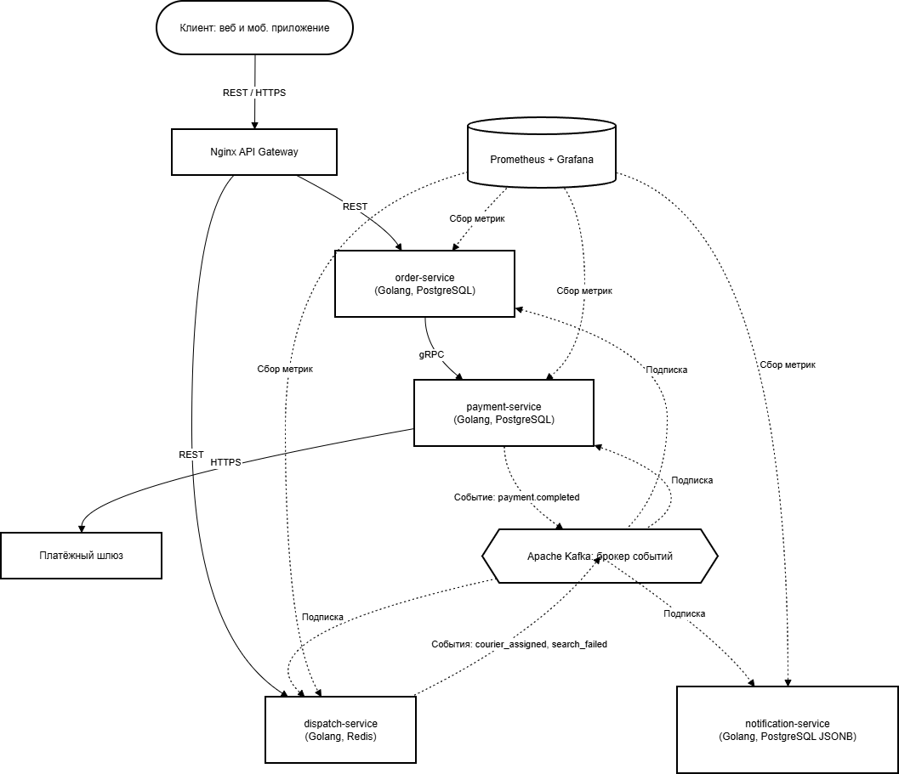
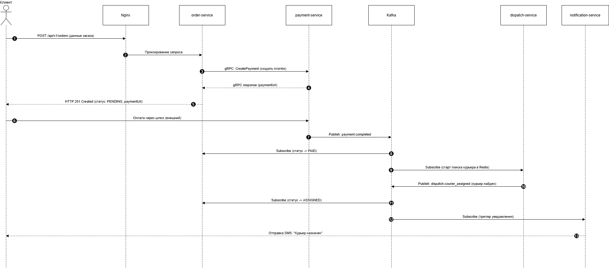

# Лабораторная работа №3. Декомпозиция и проектирование микросервисной системы

## Шаг 1. Анализ предметной области

### Описание системы
Система предназначена для оформления заявок на доставку посылок и автоматического распределения этих заявок между свободными курьерами. Платформа обслуживает клиентов (отправителей) и курьеров, а также обеспечивает прозрачное финансовое взаимодействие и информирование участников о статусе заказа.

### Акторы
* **Клиент** — создает заказы, оплачивает доставку, отслеживает статус выполнения.
* **Курьер** — выходит на смену, принимает назначенные заказы, обновляет статус доставки.
* **Платёжный шлюз (внешняя система)** — обрабатывает транзакции по картам (списание и возврат средств).
* **SMS-провайдер (внешняя система)** — отправляет уведомления клиентам и курьерам.

### Ключевые пользовательские сценарии
1. **Как клиент**, я хочу создать заказ на доставку с указанием адресов и параметров посылки, чтобы отправить груз.
2. **Как клиент**, я хочу оплатить доставку картой по выданной ссылке, чтобы заказ перешел в статус поиска курьера.
3. **Как курьер**, я хочу выйти на смену (статус «онлайн») и передавать координаты, чтобы мне начали поступать заказы.
4. **Как система**, я хочу автоматически найти ближайшего свободного курьера в Redis и назначить его на оплаченный заказ.
5. **Как курьер**, я хочу отметить заказ как «доставлен», чтобы завершить работу и зафиксировать выполнение.
6. **Как клиент**, я хочу получить SMS-уведомление о назначении курьера, чтобы знать, когда заберут посылку.
7. **Как система**, если за 15 минут курьер не найден, я хочу автоматически отменить заказ и вернуть клиенту деньги (компенсация).

### Доменные события
* `ЗаказСоздан` (`order.created`)
* `ОплатаПрошла` (`payment.completed`)
* `ОплатаОтклонена` (`payment.failed`)
* `КурьерНазначен` (`dispatch.courier_assigned`)
* `ПоискКурьераТаймаут` (`dispatch.search_failed`)
* `ЗаказДоставлен` (`order.delivered`)

### Ограниченные контексты и глоссарий

#### 1. Контекст Заказов (Order Management)
* **Заказ** — заявка на доставку с адресами отправителя и получателя, габаритами и текущим статусом жизненного цикла.
* **Клиент** — пользователь системы, выступающий заказчиком услуги доставки.
* **Посылка** — физический объект доставки, обладающий весом и габаритами.
* **Статус заказа** — состояние заявки (`PENDING`, `PAID`, `ASSIGNED`, `DELIVERED`, `CANCELLED`).

#### 2. Контекст Диспетчеризации (Dispatch & Couriers)
* **Курьер** — исполнитель со статусом занятости (свободен/занят) и текущей геопозицией.
* **Назначение** — временная или постоянная связь между конкретным заказом и назначенным курьером.
* **Смена** — период активности курьера в системе («на линии» / «офлайн»).
* **Геопозиция** — координаты исполнителя (lat, lon) с временным штампом фиксации.

#### 3. Контекст Финансов (Billing)
* **Платёж** — транзакция списания денежных средств через внешний платёжный шлюз.
* **Возврат (Refund)** — компенсирующая операция возврата средств клиенту при отмене заказа.
* **Платёжная ссылка** — URL для перенаправления клиента на форму ввода реквизитов карты.

---

## Шаг 2. Список и описание сервисов

### Карточки сервисов

#### 1. `order-service`
* **Ответственность:** Управление жизненным циклом заказа на доставку, валидация адресов, хранение истории.
* **Владеет данными:** `Заказ`, `Отправитель`, `ПараметрыПосылки`.
* **Предоставляет:** Синхронный REST API для создания/получения заказа; публикует события `order.created`, `order.delivered`.
* **Зависит от:** Синхронного gRPC-вызова к `payment-service` (создание платежа); событий `payment.completed`, `payment.failed`, `dispatch.courier_assigned`, `dispatch.search_failed`.
* **Нефункциональные требования:** Высокая доступность на чтение (клиенты регулярно опрашивают статус заказа).
* **Обоснование границы:** Ядро бизнес-логики с собственной конечной машиной состояний (state machine), отделенное от логики исполнителей и платежей.

#### 2. `dispatch-service`
* **Ответственность:** Прием геопозиций курьеров, управление сменами, поиск ближайших исполнителей по радиусу и назначение на заказ.
* **Владеет данными:** `Курьер`, `Смена`, `Геопозиция`, `Назначение`.
* **Предоставляет:** Синхронный REST API для курьеров (выход на смену, отправка координат); публикует события `dispatch.courier_assigned`, `dispatch.search_failed`.
* **Зависит от:** События `payment.completed` (начинает алгоритм подбора только после факта оплаты).
* **Нефункциональные требования:** Высокая нагрузка на запись (Write-heavy: курьеры шлют GPS-координаты каждые несколько секунд), низкая задержка ответа.
* **Обоснование границы:** Специфический профиль нагрузки (быстрые гео-запросы в in-memory хранилище) требует отдельного масштабирования независимо от заказов.

#### 3. `payment-service`
* **Ответственность:** Создание платежных сессий, прием вебхуков от банка, проведение возвратов при срыве заказа.
* **Владеет данными:** `Платёж`, `Возврат`, `Транзакция`.
* **Предоставляет:** Синхронный gRPC API (`CreatePayment`) для генерации ссылки на оплату; публикует события `payment.completed`, `payment.failed`.
* **Зависит от:** События `dispatch.search_failed` (инициирует автоматический возврат средств).
* **Нефункциональные требования:** Строгая согласованность данных (ACID), повышенные требования к безопасности и аудиту.
* **Обоснование границы:** Изоляция интеграции с внешним банковским шлюзом предотвращает каскадные сбои всей платформы при задержках на стороне банка.

#### 4. `notification-service`
* **Ответственность:** Формирование и отправка SMS-уведомлений клиентам и курьерам о ключевых статусах.
* **Владеет данными:** `ИсторияОтправок`.
* **Предоставляет:** Внешних API не предоставляет (работает исключительно по событиям).
* **Зависит от:** Событий `dispatch.courier_assigned`, `dispatch.search_failed`, `order.delivered`.
* **Нефункциональные требования:** Сбои отправки SMS не должны блокировать основной бизнес-процесс.
* **Обоснование границы:** Вспомогательный сквозной сервис; его изоляция гарантирует автономность ядра системы при недоступности SMS-шлюза.

### Отвергнутые варианты разбиения
Рассматривалось объединение `order-service` и `dispatch-service` в единый монолитный сервис доставок. От этого варианта отказались, так как работа с курьерами требует постоянного обновления их геопозиции и статусов, что создает высокую нагрузку на базу данных. Выделение диспетчеризации в отдельный сервис позволяет масштабировать его независимо от подсистемы заказов.

---

## Шаг 3. Выбор готового ПО

Разработка сервисов предполагается на языке **Golang** в связке с контейнеризацией через **Docker** (и развертыванием локально через `docker-compose`). Синхронное взаимодействие между внутренними сервисами реализовано по **gRPC**, а внешнее API для клиентов — по **REST (HTTP)**.

| Компонент | Кто использует | Обоснование |
| :--- | :--- | :--- |
| **PostgreSQL** | `order-service`, `payment-service`, `notification-service` | Обеспечивает строгую консистентность данных и ACID-транзакции, что критически важно для финансовых операций и статусов заказов. Каждый сервис имеет свою изолированную БД. |
| **Redis** | `dispatch-service` | Используется как in-memory хранилище для частого обновления геопозиций курьеров в реальном времени (`GEOADD`/`GEORADIUS`). Поддержка TTL позволяет автоматически удалять неактуальные координаты, не перегружая основную БД. |
| **Apache Kafka** | Все сервисы | Выступает в роли брокера сообщений для реализации паттерна Сага и асинхронного взаимодействия (события `payment.completed`, `dispatch.courier_assigned`, `dispatch.search_failed`). Гарантирует доставку событий нескольким подписчикам и порядок сообщений по ключу. |
| **Nginx (API Gateway)** | Вход для клиентов и курьеров | Выполняет роль API Gateway, терминирует HTTP/SSL-трафик, маршрутизирует REST-запросы к нужным микросервисам и выступает единой точкой входа. |
| **Prometheus + Grafana** | Инфраструктура | Инфраструктурное ПО для сбора метрик (Prometheus) и их визуализации (Grafana). Позволяет мониторить нагрузку на сервисы (RPS, latency gRPC/REST вызовов, ресурсы контейнеров). |

---

## Шаг 4. Схема взаимодействий

### Архитектурная схема

### Сводная таблица взаимодействий

| № | Инициатор $\rightarrow$ Получатель | Тип | Протокол / Эндпоинт или Событие | Назначение |
|---|---|---|---|---|
| 1 | Клиент $\rightarrow$ Nginx Gateway | sync | HTTP REST: `POST /api/v1/orders` | Передача данных заказа (адреса, посылка) |
| 2 | Nginx $\rightarrow$ `order-service` | sync | HTTP REST: `POST /api/v1/orders` | Проксирование создания заказа |
| 3 | Курьер $\rightarrow$ Nginx $\rightarrow$ `dispatch-service` | sync | HTTP REST: `POST /api/v1/couriers/shifts` | Выход курьера на смену, отправка координат |
| 4 | `order-service` $\rightarrow$ `payment-service` | sync | **gRPC:** `CreatePayment` | Создание платежа, получение paymentUrl |
| 5 | Клиент $\rightarrow$ `payment-service` / Шлюз | sync | HTTPS | Оплата заказа картой через шлюз |
| 6 | `payment-service` $\rightarrow$ Kafka | async | Топик `payments.events`: `payment.completed` | Оповещение об успешной оплате |
| 7 | Kafka $\rightarrow$ `order-service` | async | Подписка: `payment.completed` | Смена статуса заказа на `PAID` |
| 8 | Kafka $\rightarrow$ `dispatch-service` | async | Подписка: `payment.completed` | Старт поиска курьера в Redis |
| 9 | `dispatch-service` $\rightarrow$ Kafka | async | Топик `dispatch.events`: `dispatch.courier_assigned` | Публикация: курьер найден |
| 10 | Kafka $\rightarrow$ `order-service` | async | Подписка: `dispatch.courier_assigned` | Смена статуса заказа на `ASSIGNED` |
| 11 | Kafka $\rightarrow$ `notification-service` | async | Подписка: `dispatch.courier_assigned` | Триггер отправки SMS клиенту |
| 12 | `dispatch-service` $\rightarrow$ Kafka | async | Топик `dispatch.events`: `dispatch.search_failed` | Таймаут (15 мин), курьер не найден |
| 13 | Kafka $\rightarrow$ `order-service` | async | Подписка: `dispatch.search_failed` | Смена статуса заказа на `CANCELLED` |
| 14 | Kafka $\rightarrow$ `payment-service` | async | Подписка: `dispatch.search_failed` | Компенсирующее действие: возврат средств (Refund) |
| 15 | Kafka $\rightarrow$ `notification-service` | async | Подписка: `dispatch.search_failed` | SMS клиенту: «Курьер не найден, деньги возвращены» |

---

### Диаграмма последовательности: Успешный сценарий

### Диаграмма последовательности: Сценарий со сбоем (Сага)

### Механизм согласованности данных и обработка сбоев (Сага)
1. **Успешный путь:** Заказ создается в статусе `PENDING`. После оплаты через шлюз `payment-service` отправляет событие `payment.completed`. Сервис заказов переводит статус в `PAID`, а `dispatch-service` начинает поиск исполнителя в Redis. При нахождении публикуется `dispatch.courier_assigned`, заказ переходит в `ASSIGNED`, клиенту уходит SMS.
2. **Сценарий сбоя и компенсация:** Если за 15 минут свободный курьер не найден, `dispatch-service` генерирует событие `dispatch.search_failed`. Это запускает цепочку распределенного отката:
   * `order-service` переводит статус заказа в `CANCELLED`.
   * `payment-service` выполняет компенсирующее действие — вызывает метод возврата средств (Refund) во внешнем платёжном шлюзе.
   * `notification-service` информирует клиента об отмене и автоматическом возврате денег.
3. **Идемпотентность и защита от дублей:** Все сообщения в Kafka содержат `eventId` и `correlationId` (соответствующий `orderId`). Сервисы сохраняют идентификаторы обработанных сообщений в локальных БД, что исключает повторное списание средств или двойную отмену заказа при сетевых сбоях и повторной доставке сообщений брокером.
4. **Идемпотентность API:** Создание заказа (`POST /api/v1/orders`) поддерживает заголовок `Idempotency-Key` (UUIDv4) для предотвращения дубликатов при повторных кликах пользователя.

---

## Перечень событий Kafka

| Топик | Издатель | Подписчики | Описание события | Схема |
| :--- | :--- | :--- | :--- | :--- |
| `orders.events` | `order-service` | `notification-service` | Создание заказа, вручение посылки | [OrderEvents](api/order-service.yaml) |
| `payments.events` | `payment-service` | `order-service`, `dispatch-service` | Подтверждение оплаты (`payment.completed`), ошибка (`payment.failed`) | [PaymentEvents](api/payment-service.yaml) |
| `dispatch.events` | `dispatch-service` | `order-service`, `payment-service`, `notification-service` | Назначение курьера (`courier_assigned`), таймаут поиска (`search_failed`) | [DispatchEvents](api/dispatch-service.yaml) |

---

## Спецификации API (OpenAPI 3.1)

Контракты взаимодействия между клиентом, API Gateway и микросервисами описаны в формате OpenAPI 3.1 и лежат в директории `api/`:
* [order-service.yaml](api/order-service.yaml)
* [dispatch-service.yaml](api/dispatch-service.yaml)
* [payment-service.yaml](api/payment-service.yaml)
* [notification-service.yaml](api/notification-service.yaml)