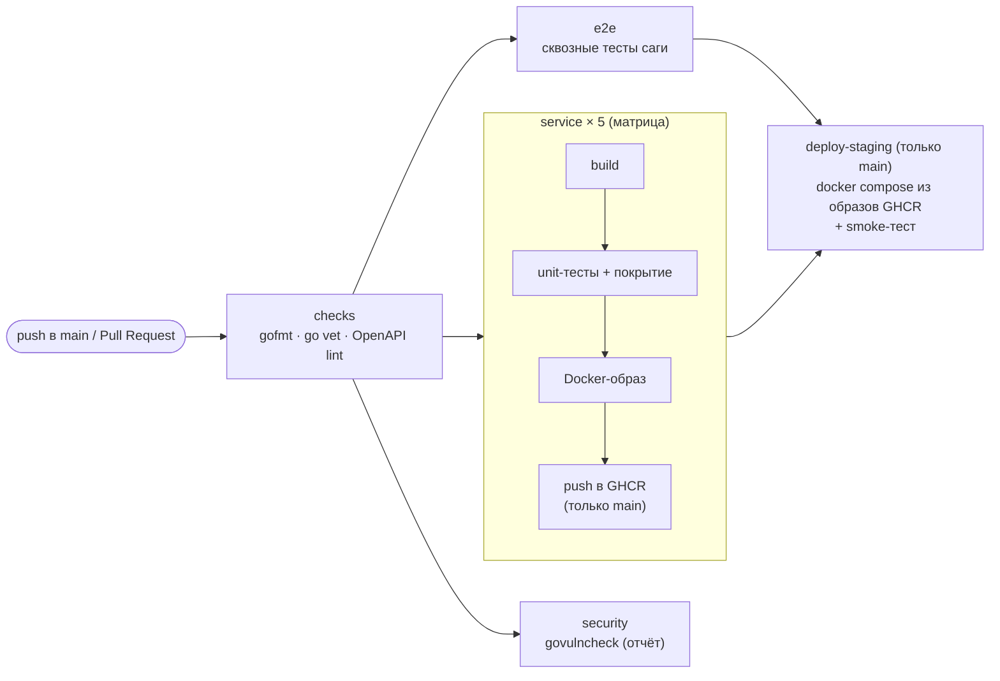

# CI/CD (лабораторная работа №5)

[](https://github.com/Nikita-Solokha/micros_labs/actions/workflows/ci-cd.yml)

Пайплайн: [`.github/workflows/ci-cd.yml`](../.github/workflows/ci-cd.yml) · все прогоны: [вкладка Actions](https://github.com/Nikita-Solokha/micros_labs/actions/workflows/ci-cd.yml) · образы: [Packages](https://github.com/Nikita-Solokha?tab=packages&repo_name=micros_labs).

## 1. Выбор платформы — GitHub Actions

* Репозиторий уже на GitHub — не нужен отдельный сервер CI (Jenkins/TeamCity) и его администрирование.
* Бесплатные раннеры Ubuntu, на которых уже есть Docker и Docker Compose, — можно развернуть всю систему прямо в пайплайне.
* Встроенный реестр образов **GitHub Container Registry (GHCR)** и встроенный секрет `GITHUB_TOKEN` — публикация образов без создания ключей вручную.
* Готовые действия для Go (`setup-go` с кэшем модулей) и Docker (`build-push-action` с кэшем слоёв).
* Матрица (`strategy.matrix`) — один шаблон пайплайна переиспользуется для всех сервисов.

## 2. Схема пайплайна



## 3. Этапы

| Job | Когда | Что делает | Падает, если |
| :--- | :--- | :--- | :--- |
| **checks** | всегда | `gofmt -l` (стиль кода), `go vet ./...` (статический анализ), проверка 4 OpenAPI-спецификаций по стандарту OpenAPI 3.1 (`openapi-spec-validator`) | код не отформатирован, vet нашёл ошибку, спецификация невалидна |
| **service** (матрица: order, dispatch, payment, notification, bank-mock) | после checks | **build** — `go build`; **test** — unit-тесты с `-race` и отчётом покрытия; **package** — сборка Docker-образа; **publish** — push в GHCR (только push в `main`) | не компилируется, упал тест, не собрался образ |
| **e2e** | после checks | сквозные тесты саги `tests/e2e`: 4 сервиса по настоящему HTTP + общий брокер — успех, курьер не найден, отказ банка, падение payment | нарушена логика саги |
| **security** | после checks | `govulncheck` — известные уязвимости в зависимостях и стандартной библиотеке, которые реально вызываются из кода | не блокирует (отчёт) |
| **deploy-staging** | только push в `main`, после service и e2e | **CD:** поднимает всю систему через `docker compose` **из только что опубликованных образов** (`docker-compose.staging.yml`, тег = коммит), прогоняет `scripts/smoke-test.sh` (20 проверок через API Gateway), при ошибке печатает логи, в конце останавливает окружение | сервисы не поднялись или smoke-тест не прошёл |

Матрица использует `fail-fast: false`: если упал один сервис, остальные всё равно собираются — сразу видно, какой именно сломан. Каждый сервис — отдельная строка в интерфейсе Actions, то есть фактически собственный пайплайн.

## 4. Триггеры

* `push` в `main` — полный CI + CD (публикация образов и деплой в staging).
* `pull_request` в `main` — только CI (сборка, тесты, сборка образов без публикации). Результат виден прямо в Pull Request.
* `workflow_dispatch` — ручной запуск кнопкой **Run workflow** во вкладке Actions.
* `concurrency` — новый push в ту же ветку отменяет устаревший прогон.

## 5. Образы и теги

Публикуются в GHCR: `ghcr.io/nikita-solokha/delivery-<сервис>`:

* `sha-<7 символов коммита>` — неизменяемый тег конкретной версии (его использует staging-деплой);
* `latest` — последняя версия из `main`.

## 6. Секреты

* Используется только **`GITHUB_TOKEN`** — встроенный секрет, который GitHub создаёт на время одного прогона и уничтожает после. Он подставляется как `${{ secrets.GITHUB_TOKEN }}` и маскируется в логах (`***`).
* Права токена минимальные и заданы явно: по умолчанию `contents: read`; `packages: write` — только у job, публикующего образы; `packages: read` — у деплоя.
* В репозитории нет ни одного пароля, ключа или токена. Секрет вебхука банка в `docker-compose.yml` (`dev-secret`) — тестовое значение заглушки, не настоящий секрет.
* Если понадобится Docker Hub: токен кладётся в **Settings → Secrets and variables → Actions** (например, `DOCKERHUB_TOKEN`) и используется как `${{ secrets.DOCKERHUB_TOKEN }}` — в коде его нет.

## 7. Кэширование

* **Модули Go** — `actions/setup-go` кэширует `~/go/pkg/mod` и кэш сборки по хэшу `go.sum`.
* **Слои Docker** — `cache-from/to: type=gha` с отдельной областью на каждый сервис: при повторной сборке слой `go mod download` и неизменившиеся слои берутся из кэша.

## 8. Как проверить работу пайплайна

**На GitHub:** вкладка **Actions** → workflow **CI/CD** → последний прогон: граф job'ов, логи каждого шага, вкладка **Summary**. Опубликованные образы — в разделе **Packages** репозитория, деплои — в **Environments → staging**.

**Запустить вручную:** Actions → CI/CD → **Run workflow** → `main`.

**Локально — те же проверки, что в CI:**

```powershell
gofmt -l .                  # пусто = код отформатирован
go vet ./...
go test -race ./...         # на Windows -race требует gcc; без него: go test ./...
docker build --build-arg SERVICE=services/order-service -t order-service .
```

**Локально — CD-часть (staging + smoke):**

```powershell
docker compose up -d --build
powershell -ExecutionPolicy Bypass -File scripts\test-saga.ps1 -Order http://localhost:8080 -Dispatch http://localhost:8080
```

(`scripts/smoke-test.sh` — bash-версия того же сценария для Linux-раннера; запускается в WSL или Git Bash при наличии `jq`.)

## 9. Демонстрация

### Успешный прогон

Прогон на `main`: все job'ы зелёные, образы опубликованы, staging развёрнут и прошёл smoke-тест.


### Неуспешный прогон

В ветке `demo/failing-test` намеренно сломан unit-тест расчёта цены (`TestCalcPrice` ожидает 500 вместо 450) и открыт Pull Request в `main`.

* Job **order-service** падает на шаге **Unit tests**; в логе видно, какой тест упал и почему.
* Шаг сборки Docker-образа для этого сервиса **не выполняется** — сломанный код не упаковывается.
* Остальные сервисы (`fail-fast: false`) собираются успешно — видно, что проблема только в order-service.
* Публикация и деплой для PR не запускаются вовсе; в Pull Request стоит красная отметка ❌, и (при включённой защите ветки) кнопка Merge заблокирована.
* PR закрыт без слияния — `main` остался зелёным.


